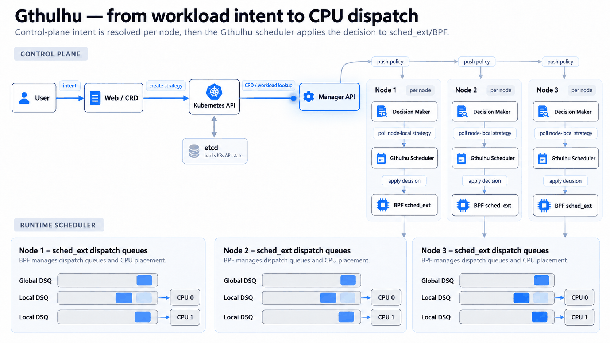

# Gthulhu

<div class="gth-hero" markdown>

## Kubernetes places the workload. Gthulhu controls how it gets CPU time.

Gthulhu bridges **Kubernetes scheduling intent** to **Linux runtime execution**. It resolves a workload down to the processes and threads that matter on each node, then applies bounded CPU scheduling policy with eBPF and Linux `sched_ext`—without replacing `kube-scheduler` or maintaining a kernel fork.

<div class="gth-hero-actions">
<a href="k8s.md" class="md-button md-button--primary">Get Started</a>
<a href="how-it-works.md" class="md-button">See How It Works</a>
</div>

</div>

<div class="gth-proof-grid" markdown>

<div class="gth-proof-card" markdown>
<span class="gth-proof-eyebrow">free5GC / 5G user plane</span>

### 97.66% lower average latency

In a published CPU-stress case study, average UE ping latency fell from **88.98 ms → 2.079 ms**.

Maximum latency also fell from **130.95 ms → 8.45 ms**.

[Read the published free5GC case study →](https://free5gc.org/blog/20251126/20251126/)
</div>

<div class="gth-proof-card" markdown>
<span class="gth-proof-eyebrow">vLLM / host-side scheduling research</span>

### Find when CPU scheduling enters the inference critical path

Our experiments study how CPU contention affects vLLM engine and feeder threads, and when host-side scheduling can recover performance. Results depend on the workload and bottleneck pattern.

[Review the benchmark and methodology →](vllm-cpu-pressure.md)
</div>

</div>

<div class="gth-trust-row" markdown>
<a href="https://landscape.cncf.io/?item=provisioning--automation-configuration--gthulhu" target="_blank"></a>
<a href="https://ebpf.io/applications/" target="_blank"></a>
<a href="https://insights.linuxfoundation.org/project/gthulhu"></a>
</div>

## The execution gap after Kubernetes placement

Kubernetes can place a workload on the right node and allocate the right resources. That still does not guarantee the workload's critical Linux threads will get CPU time when they need it.

Under contention, GPU feeder threads, `EngineCore`, packet-processing workers, IRQ-related work, or other latency-sensitive tasks can be delayed by background CPU load. The result is simple: **resources were allocated, but the runtime SLO can still be missed**.

Gthulhu focuses on that execution gap.

## From workload intent to CPU dispatch



The diagram is easier to read as four steps:

1. **Express intent** — a user or controller creates a scheduling strategy through the Web/API and Kubernetes CRDs.
2. **Resolve the workload** — the Manager watches Kubernetes state and turns that strategy into policy for the nodes that actually run the workload.
3. **Decide per node** — each node has its own Decision Maker and Gthulhu Scheduler, so policy is resolved against node-local workload/task state.
4. **Apply at CPU dispatch** — the node-local scheduler programs the eBPF `sched_ext` layer, which controls dispatch queues and CPU placement.

This keeps the responsibilities separate: Kubernetes remains responsible for **placement and allocation**; Gthulhu is responsible for **how the selected Linux tasks are scheduled at runtime**.

## Observe → target → control

<div class="gth-flow" markdown>

**1. Observe**  
Use eBPF to see which tasks are waiting, running, migrating, and competing for CPU.

**2. Target**  
Resolve Kubernetes workload intent down to the Linux process or thread that actually matters.

**3. Control**  
Use `sched_ext` to apply bounded runtime scheduling policy and protect critical execution paths.

</div>

> **Kubernetes decides where. Gthulhu controls how CPU time is delivered.**

## Built for workload-aware runtime scheduling

<div class="grid cards" markdown>

-   **Scheduling observability**

    ---

    Pod-level scheduling metrics with eBPF, plus Prometheus and Grafana integration.

-   **Fine-grained control**

    ---

    Apply scheduling intent to specific workloads, processes, or non-leader worker threads with TID-aware matching.

-   **Cloud-native operation**

    ---

    A Manager distributes policy to per-node Decision Makers, keeping execution decisions close to local workload state.

-   **Kernel-level control without a kernel fork**

    ---

    Use Linux `sched_ext` and eBPF to change CPU dispatch behavior while keeping Kubernetes resource boundaries intact.

</div>

[See the architecture in detail](how-it-works.md){: .md-button }

## Where it fits

Gthulhu is most useful when **CPU scheduling becomes part of the workload's critical path**—for example:

- packet-processing and 5G user-plane workloads under CPU pressure;
- AI / accelerator hosts where CPU-side feeder or engine threads can become a bottleneck;
- latency-sensitive services with noisy-neighbor contention;
- scheduler research that needs observable, replaceable runtime policy.

If the workload is GPU-, network-, storage-, or application-bound instead, changing CPU scheduling may not materially improve performance. Gthulhu is designed to make that distinction measurable rather than assume every workload needs a custom scheduler.

## Next: Claim2Core

Today, Gthulhu can observe and control Linux task scheduling at runtime. **Claim2Core** connects that control to Kubernetes' actual resource allocation.

```text
Kueue / Workload API
        ↓
kube-scheduler / DRA
        ↓  ResourceClaim + topology
Gthulhu Runtime Plane
        ↓  Pod / cgroup / TGID / TID
sched_ext + eBPF
        ↓
Delivered workload SLO
```

The principle is simple:

- `ResourceSlice` tells us what resources exist.
- `ResourceClaim.status.allocation` tells us what the workload actually received.
- Gthulhu turns that allocation into a verifiable runtime execution policy **without crossing the CPU/resource boundaries Kubernetes already established**.

[Explore the Claim2Core roadmap](claim2core.md){: .md-button }
