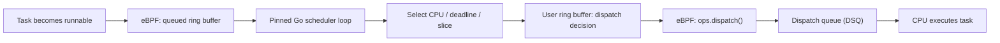

# Fine-Tuning Gthulhu's Go User-Space Scheduler: The Handoff Matters More Than the Algorithm

Gthulhu combines Linux `sched_ext`, eBPF, and Go to make scheduling decisions in user space. This flexibility comes at a cost: every task that crosses the kernel/user-space boundary needs to make it back to a dispatch queue quickly, correctly, and without losing a wakeup.

We recently investigated an uncomfortable result: our user-space scheduler would occasionally trigger `runnable task stall` watchdog errors, and the `schtest adaptive_priority` test reported a score as high as **9.66**, far above its **0.50** pass threshold. After addressing correctness issues and redesigning the handoff, repeated runs scored **0.19–0.22**; `scx_rustland` scored **0.16** in the comparison setup.

The important lesson was not that we needed a more sophisticated priority formula. **We needed to stop adding latency between a completed scheduling decision and the moment the kernel could execute it.**

This is a postmortem of the engineering decisions behind [Gthulhu PR #156](https://github.com/Gthulhu/Gthulhu/pull/156), with detailed measurements and traces in the [optimization report](https://github.com/Gthulhu/Gthulhu/blob/15bd5dd0c74c92c60574de7c03a021b538ce5124/SCHEDULER-OPTIMIZATION.md).

## How a task reaches a CPU

The user-space path is intentionally simple to describe:



Every arrow is part of the scheduler's critical path. A fast priority calculation cannot compensate for a delayed ring-buffer consumer, incorrect dispatch ordering, or a scheduler thread that keeps the CPU after making a decision.

## 1. Make Go-to-C crossings cheap—but never block there

The original hot path relied on cgo. Standard `runtime.cgocall` manages Go runtime transitions into and out of a syscall; repeatedly making these transitions can interrupt a tightly timed scheduler loop. We adopted `runtime.asmcgocall` through a narrow bridge, pinned the scheduling goroutine with `runtime.LockOSThread()`, and removed the process-wide `GOMAXPROCS(1)` restriction so other goroutines could run independently.

In a **microbenchmark of a 64-bit read**, on an Intel Xeon Platinum 8272CL with Linux 6.14 and Go 1.25.0, we measured:

| Access path | Time per operation |
| --- | ---: |
| Standard cgo | 219.6–228.1 ns |
| `asmcgocall` bridge | 20.72–21.28 ns |
| Go atomic load from mapped BPF state | 1.13–1.37 ns |

This is roughly a **10× reduction in cross-language call overhead for this microbenchmark**, *not* a 10× improvement in scheduler throughput or application performance. We also switched pure counter reads to atomic loads, avoiding C calls altogether.

There is an important constraint: `asmcgocall` bypasses the usual cgo syscall bookkeeping. Its C wrappers must remain **short and nonblocking**. No sleeping ring-buffer polling, Go callbacks, or Go-pointer ownership surprises belong there. The bridge uses POD-style arguments, explicit lifetime management, and compile-time ABI checks.

When traces initially showed `SelectCPU` wall times of 4–12 ms but only 4–48 µs of thread CPU time, that was a clue: much of the tail was **off-CPU delay**, not computation inside the C function.

## 2. Fix correctness before tuning priorities

We found several independent issues that could make runnable tasks stall.

**Symmetric filtering for scheduler threads.** After allowing more Go runtime OS threads to run, the BPF `running`, `stopping`, and `tick` hooks disagreed about which scheduler threads to exclude. One path filtered only the primary TID while another filtered the entire TGID. This corrupted `nr_running` and could trigger spurious preemption/watchdog behavior. We made the filtering consistent.

**Do not return from dispatch without actually moving work.** The old `ops.dispatch()` could attempt to move a scheduler thread from `SCHED_DSQ` and immediately return even when no thread was moved. That skipped other available DSQs. The corrected path keeps trying useful queues when the move did not succeed.

**Publish accounting before publishing the task.** The old enqueue sequence was effectively:

```c
bpf_ringbuf_submit(task, 0);
__sync_fetch_and_add(&nr_queued, 1);
```

A consumer could observe the new record before seeing its count increment, leading to an inconsistent drain decision and lost work. We changed the ordering to update `nr_queued` **before** publishing the ring-buffer record and added a regression test. This addresses the specific producer/consumer protocol in Gthulhu; it is not a general replacement for reasoning about memory ordering in every ring-buffer design.

**Make sure the tested BPF is the built BPF.** During debugging, `Makefile` generated a skeleton at a different path from the one included by the wrapper. Together with Go's cache behavior around a separately built static library, this meant code edits could appear to have no effect. Fixing the skeleton destination and rebuilding the wrapper removed that source of misleading experiments.

## 3. Understand what `adaptive_priority` actually measures

The test pits a frequently waking **Fast** worker against a CPU-intensive **Slow** worker, pinned to the same logical CPU. In the reported setup, the Fast worker busy-spins for about 100 µs and sleeps for 9.9 ms; the Slow worker busy-spins for about 10 ms.

The score is:

```text
adaptive_priority metric =
    p90(Fast wake latency) / p90(Slow wake latency)

PASS if metric < 0.50
```

**Lower is better**, but it is a *relative wakeup-latency ratio*, not CPU throughput, a universal latency percentile, or a percentage improvement in real workloads.

Our first attempt preserved each task's **full previous runnable burst** rather than just its last time slice, recognized short waking tasks in Go, and gave qualifying tasks an earlier deadline with a preemption request. This exposed another issue: a 100 µs minimum-runtime guard rejected one-shot preemption requests without retry. Removing that guard reduced the metric from **9.66 to roughly 0.88–0.95**, but still did not pass.

The remaining gap was architectural.

## 4. Four changes that closed the handoff gap

We compared the actual scheduling sequence with `scx_rustland` and identified four cooperating changes.

### Consume the queued ring buffer on the pinned thread

Previously, a background `libbpfgo` goroutine polled the queued ring buffer, ran a callback, copied data, and forwarded it over a Go channel before the scheduling loop saw a task.

Now the pinned loop calls a **nonblocking** `ring_buffer__consume_n(..., 1)` wrapper and copies the queued task directly into a bounded C buffer. This avoids channel handoff latency and makes the scheduler's ownership of work more predictable.

### Drain completed decisions before scheduling the scheduler

Previously, BPF could prioritize moving the user-space scheduler thread back onto a CPU before consuming **already completed** decisions in the dispatched user ring buffer.

Now `ops.dispatch()` first drains those user-space decisions, then considers `SCHED_DSQ`. A task that has already been selected should not wait behind another round trip through the scheduler.

### Yield the OS thread after completing dispatch

After the Go loop flushes its decisions and marks the batch complete—or finds no work—it invokes Linux `sched_yield` so the kernel can schedule the newly dispatched tasks. `runtime.Gosched()` would only yield within the Go runtime and is not equivalent.

This change is inseparable from the BPF dispatch order: **direct consumption plus yielding alone**, without draining the dispatched ring buffer first, produced an especially bad **24.48** test score. The parts need to work together.

### Separate the policy time budget from the BPF fallback slice

We kept the **20 ms** user-space scheduling budget used by deadline/vruntime logic, but set the BPF backend default slice to **1 ms**. The previous 20 ms BPF default also applied to fallback and slice-replenishment situations, where it delayed opportunities to reconsider runnable work. The two knobs serve different purposes and should not be conflated.

## 5. Results and limits

The following are **reported runs from the same Linux 6.14.0-37-generic, four-logical-CPU test environment**, using `schtest adaptive_priority`. Scores are illustrative measurements from this development investigation, not cross-hardware guarantees.

| Scheduler / stage | Metric | Outcome |
| --- | ---: | --- |
| Original Gthulhu | 5.70–9.66 | Fail |
| After removing the un-retried 100 µs guard, before handoff redesign | 0.88–1.00 | Fail |
| Direct ring-buffer + yield, without BPF drain-first ordering | 24.48 | Fail |
| Optimized Gthulhu, `builtin_idle=false` | 0.19, 0.21, 0.22 | Pass |
| Optimized Gthulhu, `builtin_idle=true` | 0.20 (5s batch: 0.22) | Pass |
| `scx_rustland`, `builtin_idle=true` | 0.16 | Pass |

Under the aligned `builtin_idle=true` condition, the observed Fast wakeup distribution's reported center was about **13.4 µs** with Gthulhu versus **11.2 µs** with `scx_rustland`. A separate `schtest --filter fairness` run for the optimized configuration reported **0.98**, above its **0.60** threshold.

These findings show that Gthulhu's **Go user-space mode can pass this targeted latency/fairness test** while retaining Go-based scheduling decisions. They do **not** establish parity on every workload, production-wide reliability, or general application speedups. Kernel version, CPU affinity, topology, configuration, contention, and future code changes matter.

## What we learned

A user-space scheduler is a distributed state machine spanning BPF, shared-memory/ring-buffer interfaces, the language runtime, and the Linux scheduler itself. Debugging it requires more than timing the scheduling function.

- Measure **wall time and thread CPU time** separately to distinguish computation from off-CPU latency.
- Treat queue counters, publication order, and dispatch queues as a single **correctness protocol**.
- When a decision has been made, **dispatch it before asking the decision maker to run again**.
- Make explicit when the user-space scheduler should **give the CPU back**.
- Verify the actual compiled BPF and measure results against a well-defined benchmark.

Our next step is to evaluate these improvements across more kernels, CPU topologies, and real workloads rather than overgeneralizing from one latency benchmark.

**Dig into the implementation:** [PR #156](https://github.com/Gthulhu/Gthulhu/pull/156) · [Detailed investigation and raw benchmark output](https://github.com/Gthulhu/Gthulhu/blob/15bd5dd0c74c92c60574de7c03a021b538ce5124/SCHEDULER-OPTIMIZATION.md) · [Gthulhu scheduler internals](how-it-works.md)
