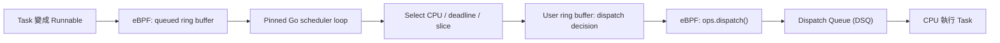

# Gthulhu Go User-Space Scheduler 最佳化實錄：真正的瓶頸不只在排程演算法

Gthulhu 透過 Linux `sched_ext`、eBPF 與 Go，讓排程決策可以在 User Space 執行。這種架構提供了策略上的彈性，但也帶來一個必須面對的問題：每個進入 User Space 的 Runnable Task，最終都必須正確且迅速地回到 Kernel 的 Dispatch Queue（DSQ），才能真正取得 CPU。

最近我們在調校 User-Space Mode 時遇到一個有趣的現象：一方面，`sched_ext` 偶爾回報 `runnable task stall`；另一方面，`schtest adaptive_priority` 的分數最高來到 **9.66**，遠高於通過門檻 **0.50**。修正底層問題並重新整理排程交接流程後，多次測試得到 **0.19–0.22**，同環境下 `scx_rustland` 的對照結果為 **0.16**。

這次最大的收穫並不是找到一套更聰明的 Priority Algorithm，而是發現：**就算 Go 已經完成排程決策，只要 Kernel 與 User Space 之間的 Handoff 不順暢，Task 還是得不到 CPU。**

本文整理 [Gthulhu PR #156](https://github.com/Gthulhu/Gthulhu/pull/156) 的主要設計與除錯經驗。更完整的 Trace、實驗紀錄與原始輸出，可參考 [Scheduler Optimization Report](https://github.com/Gthulhu/Gthulhu/blob/15bd5dd0c74c92c60574de7c03a021b538ce5124/SCHEDULER-OPTIMIZATION.md)。

## 從 Runnable 到真正執行，經過哪些步驟？



這條路徑上的每個環節都有成本。即使 Priority 計算只花幾個微秒，如果 Ring Buffer Consumer 需要經過其他 Goroutine 才能收到任務，或者 BPF 一直把 Scheduler 排回 CPU 而不先處理已完成的決策，最後的 Wakeup Latency 仍然不理想。

## 1. 降低 Go 到 C 的呼叫成本，但不能讓 Hot Path 阻塞

最初的 Hot Path 透過標準 cgo 呼叫 C Wrapper。標準的 `runtime.cgocall` 涉及 Go Runtime 的 Syscall 狀態管理；對於不斷跨越 Go/C 邊界的排程迴圈，這些開銷不容忽視。

我們做了幾項調整：

- 使用 `runtime.LockOSThread()`，讓核心排程迴圈固定在同一個 OS Thread 上；
- 移除整個程序的 `GOMAXPROCS(1)` 限制，避免 Metrics、GC 與其他 Goroutine 只能和排程迴圈搶同一個 P；
- 透過受控的 `runtime.asmcgocall` Bridge 執行短小的 C Hot Path；
- 對只需要讀取的 BPF 映射計數器，直接使用 Go Atomic Load，省掉跨語言呼叫。

在 Intel Xeon Platinum 8272CL、Linux 6.14、Go 1.25.0 上，針對單次 64-bit 數值讀取的 Microbenchmark，結果如下：

| 呼叫方式 | 每次操作耗時 |
| --- | ---: |
| 標準 cgo | 219.6–228.1 ns |
| `asmcgocall` Bridge | 20.72–21.28 ns |
| Go Atomic Load | 1.13–1.37 ns |

這代表**該 Microbenchmark 的跨語言呼叫成本約降低 10 倍**，並不代表整個 Scheduler 或 Application 快了 10 倍。

`asmcgocall` 也不是可以無限制使用的捷徑。它沒有標準 cgo 的 Syscall 交接流程，因此 C Wrapper 必須維持短小、非阻塞；不能拿來做 Sleep/Polling、回呼 Go，或隨意傳遞具有複雜生命週期的 Go Pointer。這次也加上跨語言結構的 ABI Compile-Time Check。

我們還利用 Wall Time 與 Thread CPU Time 交叉比對 `SelectCPU`：有些操作看起來花了 **4–12 ms**，實際 Thread CPU Time 卻只有 **4–48 µs**。這反而提醒我們，問題可能是 Scheduler Thread 沒有及時取得 CPU，而不是單次 C 呼叫真的執行了好幾毫秒。

## 2. 優化效能之前，先把排程正確性修好

排查過程找到幾個會導致 Runnable Task Stall 的底層問題。

### Scheduler Thread Filtering 不一致

移除 `GOMAXPROCS(1)` 後，多個 Go Runtime OS Thread 更容易同時執行。我們發現 BPF 的 `running`、`stopping` 與 `tick` Hook，對 Scheduler Thread 的排除條件不一致：有的只排除主要 Thread ID，有的卻排除整個 Process（TGID）。

這讓 `nr_running` 的計數可能失衡，也可能產生不正確的 Watchdog 或 Preemption 行為。修正方式是讓相關 Hook 使用一致的識別條件。

### 沒有成功移動 Task，卻提早從 Dispatch 返回

舊版 `ops.dispatch()` 看到 Scheduler 需要執行，就嘗試從 `SCHED_DSQ` 移動 Scheduler Thread，接著直接 Return。

問題是這次 Move 不一定成功。若沒有真正搬出任何 Task，卻放棄繼續檢查其他 DSQ，就可能讓明明已經 Runnable 的 Task 繼續等待。

### Ring Buffer Publication 與 Queue Counter 的 Race Condition

原本入隊時的操作順序大致是：

```c
bpf_ringbuf_submit(task, 0);
__sync_fetch_and_add(&nr_queued, 1);
```

這個順序有一個競爭窗口：Go Consumer 可能已經讀到剛發布的任務，但 `nr_queued` 還沒增加，導致 Consumer 依據不一致的狀態判斷並遺失工作。

因此我們將計數更新移到 Publication 之前：

```c
__sync_fetch_and_add(&nr_queued, 1);
bpf_ringbuf_submit(task, 0);
```

這個修改必須配合 Gthulhu 原本的 Producer/Consumer 計數協定理解，並非所有 Ring Buffer 都適用同一種做法。我們也加入 Regression Test，避免問題再次發生。

### 實際執行的 BPF，未必是剛剛修改的 BPF

除錯過程還發現 Makefile 產生的 BPF Skeleton 路徑，與 C Wrapper Include 的位置不同。加上獨立建置的 Static Library 與 Go Build Cache，可能造成明明更新原始碼，卻仍執行舊 BPF ELF 的狀況。

修正 Build Pipeline 之後，才有辦法確認每次實驗測試的確實是最新程式碼。

## 3. 為什麼 `adaptive_priority` 過不了？

`schtest adaptive_priority` 不是單純測量 Scheduler Throughput，而是在同一顆 Logical CPU 上安排兩種互相競爭的 Worker：

- **Fast Worker**：Busy Spin 約 100 µs，接著 Sleep 約 9.9 ms，頻繁 Sleep/Wakeup；
- **Slow Worker**：Busy Spin 約 10 ms，持續占用 CPU。

測試比較兩者的 p90 Wakeup Latency：

```text
metric = p90(Fast wake latency) / p90(Slow wake latency)

PASS: metric < 0.50
```

分數越低，表示 Fast Worker 相對於 Slow Worker 更容易及時被排到 CPU。不過這個數字是**相對喚醒延遲比例**，既不是吞吐量，也不能直接轉換成應用程式的效能提升百分比。

最初我們嘗試在 Go 裡辨識短任務：保存完整的 Previous CPU Burst，而非只看最後一段 Time Slice，並對符合條件的 Wakeup Task 給予 Deadline Bonus 與 Preemption Request。

但 BPF 當時存在一個 100 µs 的 Preemption Guard。若正在執行的 Task 尚未跑滿 100 µs，這次 Preemption 可能被拒絕，且不會重新嘗試。Trace 中曾觀察到 Fast Worker 有 **267 次**喚醒遭到這個條件擋下。

移除沒有 Retry 的保護門檻後，Metric 從 **9.66** 改善到約 **0.88–0.95**，卻還是無法通過測試。

這時我們開始和 `scx_rustland` 比較，發現最後的差距其實不是 Priority Formula，而是底層排程交接。

## 4. 四項需要互相配合的 Handoff 最佳化

### 4.1 由 Pinned Scheduler Loop 直接消費 Ring Buffer

舊架構依賴 `libbpfgo` 的背景 Goroutine Poll Ring Buffer，再透過 Callback、資料複製與 Go Channel 把 Task 傳給 Scheduler Loop。

現在改由固定 OS Thread 的 Scheduler Loop，透過非阻塞的 `ring_buffer__consume_n(..., 1)` Wrapper 直接讀取 Task，減少 Channel Handoff 與額外 Goroutine Wakeup。

這個 Wrapper 只做非阻塞的 Ring Buffer 消費與有限的資料複製，才符合前面提到的 `asmcgocall` 使用限制。

### 4.2 BPF 先 Drain 已完成的 Dispatch Decision

舊版 `ops.dispatch()` 可能先嘗試把 Go Scheduler Thread 排回 CPU，再處理 `dispatched` User Ring Buffer。

於是就算 Go 已經完成決策，Kernel 仍可能讓 Scheduler 先跑下一輪，而不是讓剛選好的 Task 執行。

新的順序是先呼叫 `bpf_user_ringbuf_drain()`，讓已完成的決策先進入排程流程，再考慮 Scheduler Thread 與其他 DSQ。

**既然決策已經完成，就不應該先把決策者重新排回來。**

### 4.3 完成 Dispatch 後，主動 Yield OS Thread

這部分特別容易被忽略：**Go Scheduler 本身也是一個 Linux Runnable Thread**。當 Scheduler 和 Application 在同一顆 CPU 上競爭時，即使 Go 已經把 Dispatch Decision 寫入 User Ring Buffer，只要它持續佔用 CPU，Application Task 仍可能無法及時執行。

因此，在完成目前的排程批次、Task Pool 清空後，我們先呼叫 `NotifyComplete(0)`，再由 `YieldScheduler()` 讓目前的 OS Thread 進入 Linux `sched_yield` 流程：

```go
if poolCount == 0 {
    if err := core.NotifyComplete(0); err != nil {
        return err
    }
    if err := bpfModule.YieldScheduler(); err != nil {
        return err
    }
}
```

這裡必須區分兩種 Yield：

- `runtime.Gosched()`：讓其他 Go Goroutine 有機會執行，不等於要求 Linux 重新排程當前 OS Thread。
- `sched_yield()`：讓目前的 Linux Thread 主動讓出 CPU 執行機會，讓 Kernel 有機會選擇其他 Runnable Task。

但要注意：`sched_yield()` **不保證下一個執行的就是 Fast Task**，更不會直接替另一顆 CPU 發出 Reschedule Request。實際效果取決於 Linux Scheduling Policy、CPU Affinity、Runnable Queue 與 BPF Dispatch 路徑。

這也是為什麼 Yield 不能單獨看待。實驗曾經只加入 Direct Ring Buffer 與 `sched_yield`，卻沒有先讓 BPF Drain 已完成的 Decision，結果 Metric 惡化到 **24.48**：Go 讓出 CPU 後，BPF 還可能優先把 Go 排回來，形成無效的往返。

所以這項優化不是「每 Dispatch 一筆就 Yield」，而是**先確保決策能被消費，完成批次之後，再適時把 CPU 交還給 Kernel**。

### 4.4 分開 User-Space Scheduling Budget 與 BPF Backend Slice

原本 BPF 的 Default Slice 是 **20 ms**，連 Fallback Dispatch 或 Slice Replenishment 等情境都會沿用，可能放大重新檢查可執行工作的等待時間。

現在讓 Go User Space 繼續使用 **20 ms** 的排程預算計算 Deadline / Vruntime，但將 BPF Backend Default Slice 調整為 **1 ms**。

兩個設定處理的是不同層次的問題，不應該當成同一個 Time Slice。

## 5. 實驗結果：從失敗到通過

以下為同一台 Linux `6.14.0-37-generic`、4 Logical CPUs 測試環境中的 `schtest adaptive_priority` 紀錄。這是特定 Benchmark 的結果，並非跨硬體或所有 Workload 的效能保證。

| Scheduler / 調整階段 | Metric | 結果 |
| --- | ---: | --- |
| 原版 Gthulhu | 5.70–9.66 | 未通過 |
| 移除無 Retry 的 100 µs Guard，尚未重構 Handoff | 0.88–1.00 | 未通過 |
| Direct Ring Buffer + Yield，未先 Drain | 24.48 | 未通過 |
| 最佳化 Gthulhu，`builtin_idle=false` | 0.19、0.21、0.22 | 通過 |
| 最佳化 Gthulhu，`builtin_idle=true` | 0.20（5s Batch：0.22） | 通過 |
| `scx_rustland`，`builtin_idle=true` | 0.16 | 通過 |

在對齊 `builtin_idle=true` 的測試條件後，Gthulhu 的 Fast Wakeup Distribution 中心值約為 **13.4 µs**，`scx_rustland` 則約為 **11.2 µs**。另外在 `schtest --filter fairness` 測試中，最佳化版本得到 **0.98**，高於通過門檻 **0.60**。

至少在這個測試環境中，Gthulhu 的 Go User-Space Mode 已經能兼顧短任務的喚醒優先順序及 Fairness，而且不需要將排程決策全面移到 Kernel 或改用其他語言。

當然，這並不等於 Gthulhu 已經在所有 Latency、Throughput 或 Production Workload 上和 `scx_rustland` 有相同表現。不同 Kernel、CPU Topology、Affinity、負載類型與 Scheduler Configuration 都可能改變結果。

## 6. 這次學到了什麼？

這次調校讓我們重新認識 User-Space Scheduler：它不是只有一段 Priority Algorithm，而是橫跨 **BPF、Ring Buffer、Go Runtime、Linux Scheduling** 的狀態機。

有幾件事值得記下來：

1. **Latency 不只有 CPU Execution Time。** 同時量 Wall Time 與 Thread CPU Time，才能分辨計算成本和 Off-CPU Delay。
2. **Queue Counter 和 Publication Order 是正確性問題。** Race Condition 可能讓 Task 直接遺失，不只是慢一點而已。
3. **已完成的 Decision 應該先被消費。** 不然 Scheduler 可能一直把自己排回來，卻讓 Application Task 等待。
4. **Scheduler 必須知道何時交還 CPU。** 在特定 CPU Contention 情境下，適當的 `sched_yield` 能減少不必要的排程延遲。
5. **Benchmark 必須說清楚量測什麼。** Microbenchmark 的呼叫成本、`adaptive_priority` 的相對延遲比例，不能混同於應用程式整體效能。

後續還需要在不同 Kernel、CPU Topology 與實際 Workload 上驗證這套調整，尤其值得比較 Shared CPU、Dedicated Scheduler CPU 與不同 Contention Level 下的 Tail Latency 與 Context Switch Cost。

完整程式碼與量測紀錄：[Gthulhu PR #156](https://github.com/Gthulhu/Gthulhu/pull/156) · [Scheduler Optimization Report](https://github.com/Gthulhu/Gthulhu/blob/15bd5dd0c74c92c60574de7c03a021b538ce5124/SCHEDULER-OPTIMIZATION.md) · [Gthulhu 運作原理](how-it-works.md)
