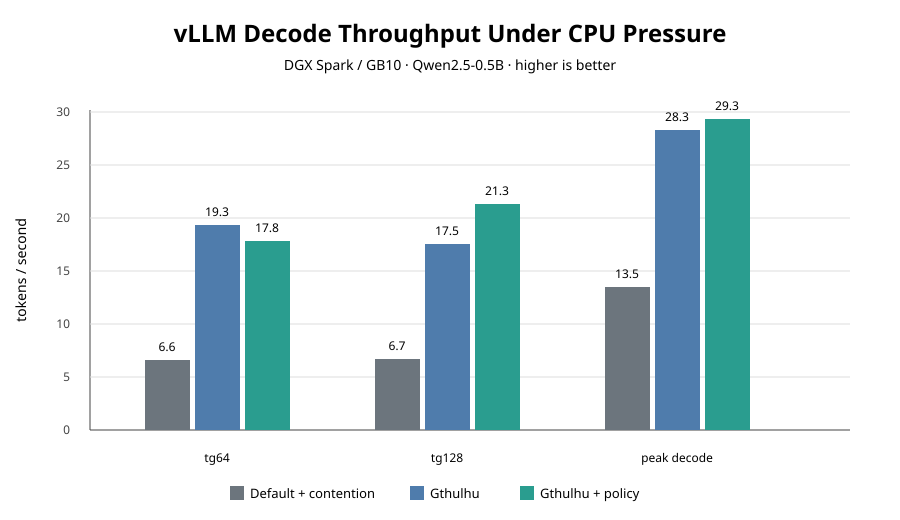
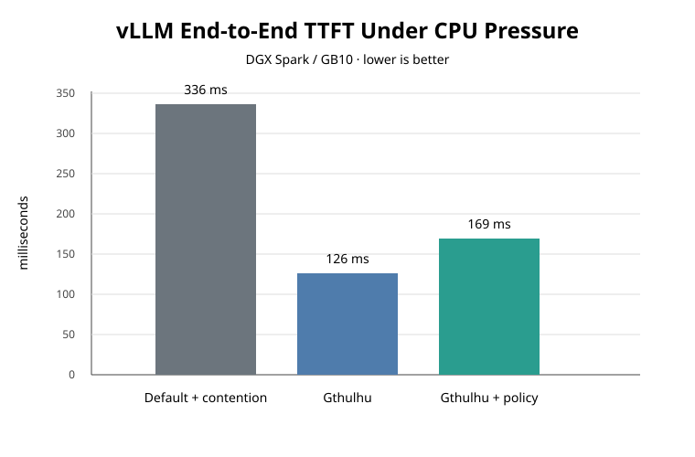

# When Does CPU Scheduling Help AI Inference?

LLM inference is usually discussed as a GPU problem. That is mostly reasonable: matrix multiplication, attention, KV-cache access, and model execution dominate the compute budget. But a production inference service is not only a collection of GPU kernels.

The host still has to accept requests, tokenize input, schedule work, launch kernels, process GPU interrupts, move data, run communication progress threads, and keep the surrounding Kubernetes stack alive. If those CPU-side tasks cannot run when the accelerator needs them, the GPU can become indirectly starved.

This post combines two sets of experiments around Gthulhu and vLLM:

1. our original **single-node GB10 experiment**, where deliberate CPU saturation severely degraded vLLM and `sched_ext` scheduling recovered much of that loss; and
2. later **DGX Spark tester results**, which showed both sides of the story: CPU contention can materially hurt multi-node inference, but static pinning may already solve a stable placement problem, and some GPU/network-bound workloads barely respond to CPU scheduling at all.

The useful conclusion is therefore not "a custom scheduler makes AI inference faster." It is narrower:

> **CPU scheduling helps AI inference when latency-sensitive host work is on the inference critical path and is competing for CPU service.**

When the bottleneck is elsewhere, changing the CPU scheduler should not be expected to move the result.

## Why CPU scheduling can enter the inference critical path

A vLLM deployment typically has CPU-sensitive work around the accelerator:

- HTTP / streaming request handling;
- tokenization and preprocessing;
- vLLM scheduler and `EngineCore` work;
- CUDA kernel submission;
- GPU IRQ handling and driver work;
- NCCL / RDMA progress in distributed serving;
- data loading, model staging, metrics, logging, and other host-side helpers.

On a Kubernetes node, those tasks also share CPUs with kubelet, containerd, the CNI, device plugins, observability agents, and colocated applications.

So even if the model itself is GPU-bound, a simple dependency chain still exists:

```text
request
  ↓
CPU front-end / tokenizer
  ↓
CPU engine / kernel submission
  ↓
GPU execution
  ↓
IRQ / completion / communication progress
  ↓
CPU schedules the next step
```

If the CPU portions of this loop are delayed, the GPU may have no useful work to execute even though the GPU itself is not saturated.

That is the scenario where CPU scheduling becomes relevant.

---

## Experiment 1: deliberately CPU-starving a single-node vLLM service

Our original experiment used:

- NVIDIA DGX Spark / GB10-class hardware;
- Linux 6.17;
- MicroK8s;
- vLLM with `Qwen/Qwen2.5-0.5B-Instruct`;
- `stress-ng --cpu 16` to create sustained host CPU pressure;
- Gthulhu on top of Linux `sched_ext`.

The contention is intentionally aggressive. The purpose is to expose scheduler behavior, not to represent every inference deployment.

We compared three scenarios:

- **A. Default scheduler + CPU pressure** — Linux EEVDF, no Gthulhu.
- **B. Gthulhu, no explicit policy** — swap the scheduler while keeping the same contention.
- **C. Gthulhu + workload policy** — additionally protect GPU/driver work and vLLM's decode-side hot path.

### A. Default scheduler under CPU pressure

| model | test | t/s | peak t/s | e2e TTFT |
| --- | ---: | ---: | ---: | ---: |
| Qwen2.5-0.5B | pp128 | 6066.73 ± 9059.47 | — | 253.36 ± 149.02 ms |
| Qwen2.5-0.5B | tg64 | 7.39 ± 2.00 | 14.30 ± 9.79 | — |
| Qwen2.5-0.5B | tg128 | 7.20 ± 1.34 | 20.80 ± 14.65 | — |
| Qwen2.5-0.5B | pp256 | 2420.16 ± 4980.19 | — | 368.13 ± 103.26 ms |
| Qwen2.5-0.5B | tg64 | 6.37 ± 0.81 | 9.70 ± 4.84 | — |
| Qwen2.5-0.5B | tg128 | 6.44 ± 0.72 | 14.10 ± 10.72 | — |
| Qwen2.5-0.5B | pp512 | 1580.57 ± 62.92 | — | 385.09 ± 12.68 ms |
| Qwen2.5-0.5B | tg64 | 6.16 ± 0.33 | 8.20 ± 2.23 | — |
| Qwen2.5-0.5B | tg128 | 6.39 ± 0.64 | 13.90 ± 10.22 | — |

Decode was effectively stuck around **6–7 tok/s**, while TTFT reached roughly **250–390 ms**.

### B. Gthulhu scheduler, without an explicit workload policy

| model | test | t/s | peak t/s | e2e TTFT |
| --- | ---: | ---: | ---: | ---: |
| Qwen2.5-0.5B | pp128 | 16853.04 ± 22651.21 | — | 95.29 ± 95.05 ms |
| Qwen2.5-0.5B | tg64 | 19.57 ± 3.76 | 27.70 ± 6.54 | — |
| Qwen2.5-0.5B | tg128 | 17.34 ± 3.38 | 28.42 ± 7.77 | — |
| Qwen2.5-0.5B | pp256 | 31951.35 ± 45929.49 | — | 142.15 ± 133.51 ms |
| Qwen2.5-0.5B | tg64 | 20.53 ± 2.98 | 27.90 ± 6.82 | — |
| Qwen2.5-0.5B | tg128 | 17.50 ± 2.69 | 29.50 ± 4.88 | — |
| Qwen2.5-0.5B | pp512 | 24737.77 ± 22759.95 | — | 140.91 ± 103.17 ms |
| Qwen2.5-0.5B | tg64 | 17.86 ± 3.97 | 25.55 ± 5.59 | — |
| Qwen2.5-0.5B | tg128 | 17.56 ± 3.07 | 31.00 ± 7.35 | — |

Decode increased to roughly **17–20 tok/s**, while TTFT fell to roughly **95–142 ms**.

This is an important detail: no application-specific policy had been applied yet. Gthulhu's scheduling core derives from `scx_bpfland`, whose interactive scheduling behavior naturally favors tasks that frequently sleep, wake, and yield over pure CPU burners that continuously consume their time slice. vLLM's decode-side control path has much more of that interactive behavior than `stress-ng --cpu`.

### C. Gthulhu with workload-aware policy

The policy further protected host work associated with the GPU/inference loop, including NVIDIA IRQ/driver work and vLLM's `EngineCore` path.

| model | test | t/s | peak t/s | e2e TTFT |
| --- | ---: | ---: | ---: | ---: |
| Qwen2.5-0.5B | pp128 | 9892.80 ± 18487.97 | — | 187.25 ± 126.13 ms |
| Qwen2.5-0.5B | tg64 | 17.03 ± 4.30 | 25.40 ± 7.34 | — |
| Qwen2.5-0.5B | tg128 | 22.96 ± 7.02 | 34.17 ± 6.54 | — |
| Qwen2.5-0.5B | pp256 | 7899.74 ± 8421.16 | — | 162.23 ± 116.04 ms |
| Qwen2.5-0.5B | tg64 | 15.62 ± 3.58 | 24.75 ± 7.14 | — |
| Qwen2.5-0.5B | tg128 | 22.28 ± 6.09 | 33.26 ± 8.26 | — |
| Qwen2.5-0.5B | pp512 | 19734.13 ± 16280.40 | — | 158.73 ± 132.23 ms |
| Qwen2.5-0.5B | tg64 | 20.69 ± 5.96 | 28.80 ± 7.88 | — |
| Qwen2.5-0.5B | tg128 | 18.69 ± 3.20 | 29.40 ± 7.07 | — |

Aggregating the decode-focused results:

| Scenario | tg64 | tg128 | peak decode | e2e TTFT |
| --- | ---: | ---: | ---: | ---: |
| A. Default + contention | ~6.6 tok/s | ~6.7 tok/s | ~13.5 tok/s | ~336 ms |
| B. Gthulhu | ~19.3 tok/s | ~17.5 tok/s | ~28.3 tok/s | ~126 ms |
| C. Gthulhu + policy | ~17.8 tok/s | **~21.3 tok/s** | **~29.3 tok/s** | ~169 ms |





The benchmark figures are stored with this documentation rather than depending on the upstream vLLM PR branch.

### Why did decode improve while TTFT did not keep improving?

The policy was aimed mainly at the decode-side GPU loop:

```text
EngineCore → kernel submission → GPU → interrupt/completion → EngineCore
```

But TTFT and prefill depend on a longer path:

```text
benchmark client
  → HTTP / socket
  → uvicorn API server
  → tokenizer
  → vLLM scheduler
  → EngineCore
  → GPU
```

Protecting the decode hot path does not automatically protect every stage before it. In scenario C, more CPU service was directed toward decode-critical work, so `tg128` improved while TTFT regressed relative to scenario B.

That is not a contradiction. It shows that scheduling policy has to match the SLO being optimized. "Prioritize vLLM" is too coarse; TTFT, prefill, decode, networking, and distributed communication may require different task-level treatment.

---

## Experiment 2: independent DGX Spark follow-up

A later tester ran a two-node DGX Spark / GB10 setup using tensor parallelism (`TP=2`) over RoCE/NCCL. This experiment is useful because it tested a much less pathological workload and compared the default scheduler with simple static CPU placement.

The relevant results were:

| Scenario | Decode throughput | TTFT |
| --- | ---: | ---: |
| Idle, default scheduling | **23.96 ± 2.24 tok/s** | 326 ms |
| Idle, pinned to 10 Cortex-X925 fast cores | 22.88 ± 2.16 tok/s | 313 ms |
| CPU contention, default scheduling | **17.51 ± 4.03 tok/s** | 387 ms |
| CPU contention, pinned to 10 Cortex-X925 fast cores | **22.34 ± 1.39 tok/s** | **274 ms** |

There are several useful observations here.

### 1. Under no contention, pinning did not make inference faster

The default scheduler already placed the workload well enough. Static pinning actually produced slightly lower average throughput than the idle default case.

This is a good counterexample to the idea that "more scheduler tuning is always better." If CPU placement is already adequate and the host is not under pressure, there may be nothing useful for a custom scheduler to fix.

### 2. Under contention, host scheduling became part of the distributed inference bottleneck

Adding CPU spinners reduced default throughput from **23.96 to 17.51 tok/s**, about a **27% drop relative to the idle result**, and variance increased significantly.

Simply isolating the vLLM work onto the fast Cortex-X925 cores brought throughput back to **22.34 tok/s** and improved TTFT from **387 ms to 274 ms**.

The workload spans two machines and uses NCCL/RoCE, yet starving host-side work on one node was enough to gate end-to-end decode progress. Distributed GPU inference is still dependent on host scheduling.

### 3. Static pinning is a strong baseline

This result is also a challenge for Gthulhu.

If contention is stable and the correct cores are known in advance, `taskset`, cpusets, or Kubernetes CPU management can be simple and effective. A dynamic scheduler does not deserve to exist merely because "contention hurts performance."

The benchmark for Gthulhu therefore needs to be:

```text
default scheduling
        vs
static isolation / pinning
        vs
Gthulhu dynamic scheduling
```

and it needs scenarios where the best decision changes during runtime.

---

## A third result: sometimes scheduling barely matters

Another GB10 test produced the opposite outcome: heavy CPU pressure caused little change to the measured inference result, and scheduler changes provided almost no benefit.

The reason was straightforward: that workload was primarily constrained by **GPU and/or network execution**, not by host CPU scheduling.

This negative result is just as important as the large recovery in Experiment 1.

A scheduler can only improve time spent waiting for schedulable CPU resources. It cannot manufacture GPU compute, HBM bandwidth, PCIe bandwidth, RoCE bandwidth, or faster collective communication.

---

# So when does a scheduler help AI inference?

The experiments suggest thinking in terms of the **bottleneck pattern**, not the model name or GPU type.

## Case 1: CPU contention delays a latency-sensitive host-side loop — **high potential**

Examples:

- `EngineCore` or similar engine threads frequently wake but cannot get CPU time;
- GPU IRQ / driver work is delayed by CPU burners;
- tokenization or API-server workers contend with batch jobs;
- NCCL / RDMA progress threads are starved;
- a node is intentionally oversubscribed to improve accelerator utilization.

Typical symptoms include:

- throughput drops when unrelated CPU load is introduced;
- TTFT / ITL or decode jitter rises with CPU pressure;
- GPU utilization develops gaps even though requests are queued;
- static CPU isolation restores much of the loss.

This is the strongest signal that CPU scheduling is worth investigating.

## Case 2: the workload has interactive and batch tasks sharing the same CPUs — **good fit for workload-aware scheduling**

AI serving has heterogeneous host tasks. Some run continuously; others execute briefly, sleep on GPU/network completion, and must wake quickly.

A fair scheduler does not necessarily know which wakeup is part of the inference critical path. `sched_ext` gives us a way to encode or learn that distinction.

This is especially interesting when a node combines inference with preprocessing, checkpointing, model download/staging, observability, or other background work.

## Case 3: static pinning solves the problem permanently — **custom scheduling may add little**

If the workload always runs on the same topology and the contention pattern is predictable, reserving CPUs may be enough.

In that case, dynamic scheduling has to justify itself through something static pinning cannot handle, for example:

- contention moves between CPU groups;
- workload phases change from prefill to decode to communication;
- several inference services have different priorities;
- model staging temporarily consumes CPU and I/O;
- fast cores are shared rather than permanently dedicated;
- resource allocation or topology changes as Pods scale or move.

This is where Gthulhu's longer-term value should be tested.

## Case 4: GPU, memory, or network is already the bottleneck — **low potential**

If the CPU can always feed the accelerator and progress communication quickly enough, changing CPU scheduling will do little.

Examples include:

- GPU compute is continuously saturated;
- the model is memory-bandwidth bound;
- inter-node communication dominates and CPU progress is not being starved;
- the host has abundant idle CPU capacity;
- adding CPU load does not change inference metrics.

In those cases, the right optimization target is elsewhere.

---

## A practical diagnostic before trying a custom scheduler

Before attributing an inference problem to Linux scheduling, run a simple A/B sequence:

1. measure the uncontended baseline;
2. add controlled CPU contention and check whether throughput, TTFT, ITL, or jitter changes;
3. pin or isolate critical inference threads/CPUs;
4. see whether the lost performance returns;
5. only then compare a dynamic scheduler against that static baseline.

Conceptually:

```text
Does CPU pressure hurt inference?
        │
        ├── no ──→ CPU scheduler is probably not the bottleneck
        │
        └── yes
             │
             ▼
Does static CPU isolation recover it?
        │
        ├── no ──→ investigate GPU / memory / network / application path
        │
        └── yes
             │
             ▼
Is the optimal placement stable?
        │
        ├── yes ──→ static pinning may be sufficient
        │
        └── no ──→ dynamic workload-aware scheduling becomes interesting
```

This is a much stronger methodology than quoting a single speedup number.

## Where Gthulhu fits

Gthulhu is not a GPU scheduler. `sched_ext` does not schedule CUDA kernels, GPU SMs, MIG instances, or NIC hardware queues.

Its role is the host execution layer:

```text
Kubernetes / DRA / Kueue
    allocation, admission, placement
              ↓
Gthulhu
    Pod / workload → Linux tasks → runtime CPU policy
              ↓
sched_ext
    decides when runnable host tasks receive CPU service
              ↓
GPU / network progress
```

The longer-term Claim2Core direction is to connect Kubernetes allocation and topology information to that runtime layer, so policy can be based on the workload and the resources it actually received rather than on hand-written process names alone.

For AI inference, the more interesting future benchmarks are therefore not another synthetic "3×" demonstration. They are scenarios such as:

- default vs static pinning vs Gthulhu under competing fast-core workloads;
- moving CPU contention;
- prefill/decode phase-aware scheduling;
- priority isolation between multiple inference services;
- model-staging or checkpoint workloads interfering with serving;
- multi-node inference where NCCL/RDMA progress threads become CPU-sensitive;
- runtime placement informed by CPU/GPU/NIC/NUMA topology.

## Conclusion

The original GB10 experiment showed a dramatic recovery because we intentionally created a CPU-scheduling bottleneck. The later DGX Spark experiments made the conclusion more precise.

**CPU scheduling is useful for AI inference when host-side latency-sensitive tasks are being delayed enough to stall accelerator or distributed-system progress.** Under those conditions, both static isolation and workload-aware scheduling can recover meaningful throughput and latency.

But the scheduler is not a general inference accelerator. When the workload is already GPU-, memory-, or network-bound, the effect can be negligible. And when the contention pattern is static, simple CPU pinning may be all that is required.

That gives Gthulhu a clearer research target: not "beat the default scheduler on a permanently overloaded CPU," but **adapt when the workload, priority, contention, and topology change faster than static placement can reasonably follow**.

## Related links

- [Gthulhu](https://github.com/Gthulhu/Gthulhu)
- [Gthulhu Claim2Core roadmap](https://github.com/Gthulhu/Gthulhu/issues/141)
- [Original vLLM community blog PR](https://github.com/vllm-project/vllm-project.github.io/pull/300)
- [`sched_ext` / scx](https://github.com/sched-ext/scx)
